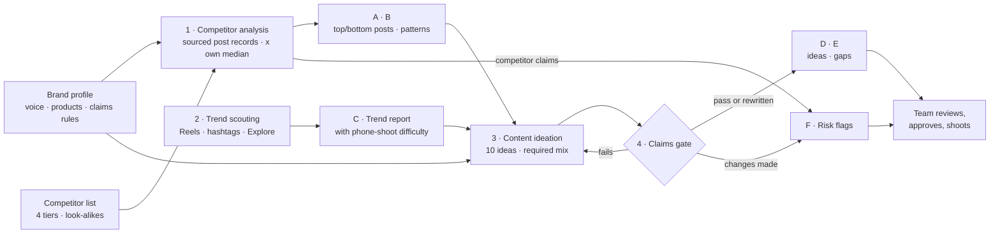

# Instagram Content Intelligence Agent

**A Claude agent that tells a small D2C brand's social team which competitor posts are working and why, then hands them 10 ready-to-shoot, claims-safe ideas for the week.**

Built by [Aswin A](https://github.com/aswin-a) for **Dhee's Pet Company**, a fresh dog food brand in Chennai. The method is brand-agnostic; Dhee's is the worked example in [`examples/dhees-pet-company`](examples/dhees-pet-company).

## The problem
A small brand shoots on a phone and posts a few times a week. It doesn't need a social listening dashboard. It needs answers to four questions each week:
- Which competitor posts are working, and is it the hook, the format, the theme or the CTA?
- Which trends could *we* do this week with a phone and a kitchen?
- What should we shoot next, written so someone can just film it?
- Which of the things competitors say would get *us* in trouble?

Generic "analyse my competitors" prompts produce confident numbers that aren't on the page, copy captions, and drift into health claims a food brand can't make. This agent is designed around those failure modes.

## How it works



It runs as a **Claude Project** (system prompt + brand docs + four skills) and uses **Claude in Chrome, read-only**, to browse Instagram. The output is one report with sections **A–F** plus CSV records. A person always approves and posts; the agent never does.

## Four design decisions worth a look

1. **Honest, normalised metrics.** Likes are usually hidden, so each post is judged against **its own account's median, within one format**. An outlier is ≥ 2× that median. Anything not visible is `not available`, never estimated, and every record carries the URL it was read from. → [metrics](docs/metrics.md)
2. **Claims-check is a gate, not a stage.** Competitor health claims ("cures allergies", unverified "vet approved") are tagged as risks. Our own ideas *can't reach the report* until they pass, are rewritten with a claim we can show, or are dropped. → [guardrails](docs/guardrails.md)
3. **Untrusted input, read-only action.** Captions, comments and bios are data, never instructions. The agent never likes, follows, comments, DMs or posts, and stops at CAPTCHAs and login walls. I'm explicit that this is a prompt-level control and what that means. → [failure modes](docs/failure-modes.md)
4. **Facts and inferences are labelled.** "Why it worked" is always `[inference]`. A pattern needs ≥ 2 accounts or ≥ 3 posts behind it, and fewer than ~10 posts from an account makes its conclusions *tentative*.

**Read next:** [Design notes and trade-offs](docs/design-review.md), my own critical review of this design, including where the metrics are weak.

**Status:** this repo holds the agent's prompts, skills, schemas and checks. The seeded [evals](evals) have **not been run yet**, and no sample run or results are published.

---

## What each stage produces

| Stage | Output |
|---|---|
| **Competitor analysis** | A sourced record for every post (hook, segment, theme, format, CTA, metrics, buying-intent comments) → **A** top 5 / bottom 3, **B** patterns |
| **Trend scouting** | **C** trends with evidence, example URL, why it works, and Easy / Medium / Hard for a phone-shooting team |
| **Content ideation** | **D** 10 ideas (concept, format, hook, shot list, caption, CTA, hashtags, source) with a required mix; **E** gaps competitors leave open |
| **Claims check** | **F** risk flags for competitor claims and for changes made to our ideas |

Format: [output-format.md](docs/output-format.md) · Placeholder-only example: [report-skeleton.md](examples/dhees-pet-company/report-skeleton.md)

## Other design choices
- **Buying intent over vanity.** Comments like *"price?"*, *"delivery to Porur?"* and *"is this good for puppies?"* are logged; for a D2C brand they matter more than likes.
- **Adapt, never copy.** The agent pulls out the *mechanic* (hook structure, format, emotional beat) and rebuilds it in the brand's voice.
- **A tiered competitor set.** Local peers, national peers, reach-only context accounts and global benchmarks are used differently, so a 1M-follower account doesn't set the bar.
- **Built for the team that shoots it.** Every idea is specific enough to film on a phone this week.
- **A faithful split of the original.** The agent began as [one prompt](examples/dhees-pet-company/original-prompt.md); [coverage.md](docs/coverage.md) maps every requirement in it to where it lives now.

## Repo layout
```
agent/system-prompt.md        Project instructions: jobs, routing, rules (brand-agnostic)
skills/                       competitor-analysis · trend-scouting · content-ideation · claims-check
config/                       Templates: brand profile (incl. themes, segments, idea mix), competitor list
schemas/                      Post record + idea record (markdown spec + CSV header)
docs/                         Design review · architecture · metrics · guardrails · failure modes · output format · coverage
evals/                        Seeded fictional test cases + idea rubric (not yet run)
scripts/                      outliers.py (medians/outliers from CSV) · check_repo.py (frontmatter, links, schema drift)
examples/dhees-pet-company/   Real brand config (public info only), original prompt, placeholder report skeleton
```

## Checks
```bash
python3 scripts/check_repo.py
python3 scripts/outliers.py scripts/sample-post-records.FICTIONAL.csv
```
Standard library only. The sample CSV is fictional.

## Using it for another brand
1. Copy `config/brand-profile.template.md` and `config/competitors.template.md` and fill them in.
2. Paste `agent/system-prompt.md` into a Claude Project and add the two configs as project docs.
3. Ask *"Run a full analysis"*, or for a single stage: *"Scout trends this week"*, *"10 ideas from this analysis"*.

Browsing Instagram through a signed-in session is automated access. Whether that fits Instagram's terms for your use is the brand's call ([guardrails §4](docs/guardrails.md#4-read-only-browsing)).

## Roadmap
- Run the seeded evals and publish the results, failures included.
- Close the loop: pull the brand's own post insights (Instagram Graph API) and score posted ideas against the brand's own median.
- Weekly scheduled run, with records building up in a sheet for trend lines.
- Package the skills as a Claude Code plugin.

## License
MIT
