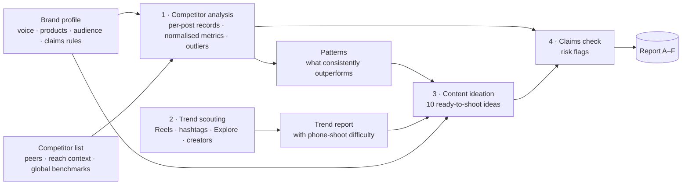

# Instagram Content Intelligence Agent

A Claude agent for a small D2C brand's social team. It studies competitors' Instagram posts, works out what actually performs (and why), scouts trending formats, and turns the findings into **ready-to-shoot content ideas in the brand's own voice**. It never copies, never invents metrics, and never touches an account.

> Built by [Aswin A](https://github.com/aswin-a) for **Dhee's Pet Company**, a fresh dog food brand in Chennai. The core agent is brand-agnostic; Dhee's is included as the worked example in [`examples/dhees-pet-company`](examples/dhees-pet-company).

---

## The problem

A small brand's team shoots on a phone and posts a few times a week. They don't need a social listening dashboard. Every week they need answers to:

- Which competitor posts are working, and is it the hook, the format, the theme or the CTA?
- Which trends could *we* do this week with a phone and a kitchen?
- What should we shoot next, written out so someone can just film it?
- Which of the things competitors say would get us in trouble?

Generic "analyse my competitors" prompts give confident numbers that aren't on the page, copy captions, and drift into claims a food brand can't make. This agent is designed around those failure modes.

## What it does



| Stage | Output |
|---|---|
| **Competitor analysis** | A record for every post (hook, dog segment, theme, format, CTA, metrics) plus top-5 and bottom-3 posts with the pattern behind each |
| **Trend scouting** | Trends with what it is, example account, why it works, and Easy / Medium / Hard for a small phone-shooting team |
| **Content ideation** | 10 ideas with concept, format, hook line, shot list or slide outline, caption draft, CTA, hashtags and source inspiration, with a required mix (life-stage, education/trust, customer proof, breed-specific) |
| **Claims check** | Competitor claims and trends **not** to copy, and a pass over our own ideas |

The report always has six sections: **A** performance summary · **B** patterns · **C** trend report · **D** content ideas · **E** gaps & opportunities · **F** risk flags. → [docs/output-format.md](docs/output-format.md)

## Key design decisions

1. **Normalised, honest metrics.** Instagram hides likes on most posts, so Reels are judged by *views ÷ followers* and against **the account's own median**, and only compared within the same format. Outliers are posts at 2×+ the account's median. Any number that isn't visible is recorded as `not available`, never estimated. → [docs/metrics.md](docs/metrics.md)
2. **Facts and inferences are labelled.** Every "why it likely worked" is marked as inference. Fewer than ~10 posts from an account means its conclusions are flagged *tentative*.
3. **Buying-intent signals over vanity.** Comments like *"price?"*, *"delivery to Porur?"* or *"is this good for puppies?"* are logged, because for a D2C brand they matter more than likes.
4. **Claims guardrails built in.** Health claims a fresh food brand can't back up (prevents, treats or cures disease, longer life) are flagged as a *risk*, never as a tactic. "Vet approved" or "clinically proven" is only used when confirmed. Ideas lean on claims the brand can show: ingredients, macros, freshness, delivery, real customers who've given permission. → [docs/guardrails.md](docs/guardrails.md)
5. **Adapt, never copy.** Captions, scripts and visuals are never reproduced. The agent pulls out the *underlying idea* and rebuilds it in the brand's voice.
6. **Read-only browsing.** No likes, follows, comments, DMs or posts, ever.
7. **A tiered competitor set.** Direct local peers, national category peers, reach-only context accounts (big pet brands, not fresh-food peers) and global benchmarks are analysed differently, so a 1M-follower account doesn't skew what "good" looks like.
8. **Built for the team that has to shoot it.** Every idea is specific enough to film on a phone this week, and every trend is rated for that team.

## Repo layout

```
agent/system-prompt.md          The agent's instructions (brand-agnostic; reads config)
skills/
  competitor-analysis/          Collect posts, record fields, normalise metrics, find patterns
  trend-scouting/               Explore Reels/hashtags/creators for formats, hooks, audio
  content-ideation/             Turn findings into 10 ready-to-shoot ideas with a required mix
  claims-check/                 Risk-flag competitor claims and our own drafts
config/                         Templates: brand profile, competitor list
schemas/                        Post record schema + CSV template
docs/                           Architecture, metrics method, guardrails, output format
examples/dhees-pet-company/     Real brand config + an illustrative report skeleton
```

## Stack
- **Claude** (Project with custom instructions + project docs)
- **Claude in Chrome**, read-only, to browse Instagram as a normal signed-in viewer
- Optional: a Google Sheet for the post records, so results build up over runs

## Using it for another brand
1. Copy `config/brand-profile.template.md` and `config/competitors.template.md` and fill them in.
2. Paste `agent/system-prompt.md` into a Claude Project and add the two configs as project docs.
3. Ask: *"Run a full analysis"*, or a single stage: *"Scout trends this week"*, *"10 ideas from last week's analysis"*.

## Roadmap
- Run it weekly as a scheduled task, with the post records adding up in a sheet for trend lines.
- Link ideas to Dhee's own post performance, to close the loop on what worked.
- Package the skills as an installable plugin.

## License
MIT
