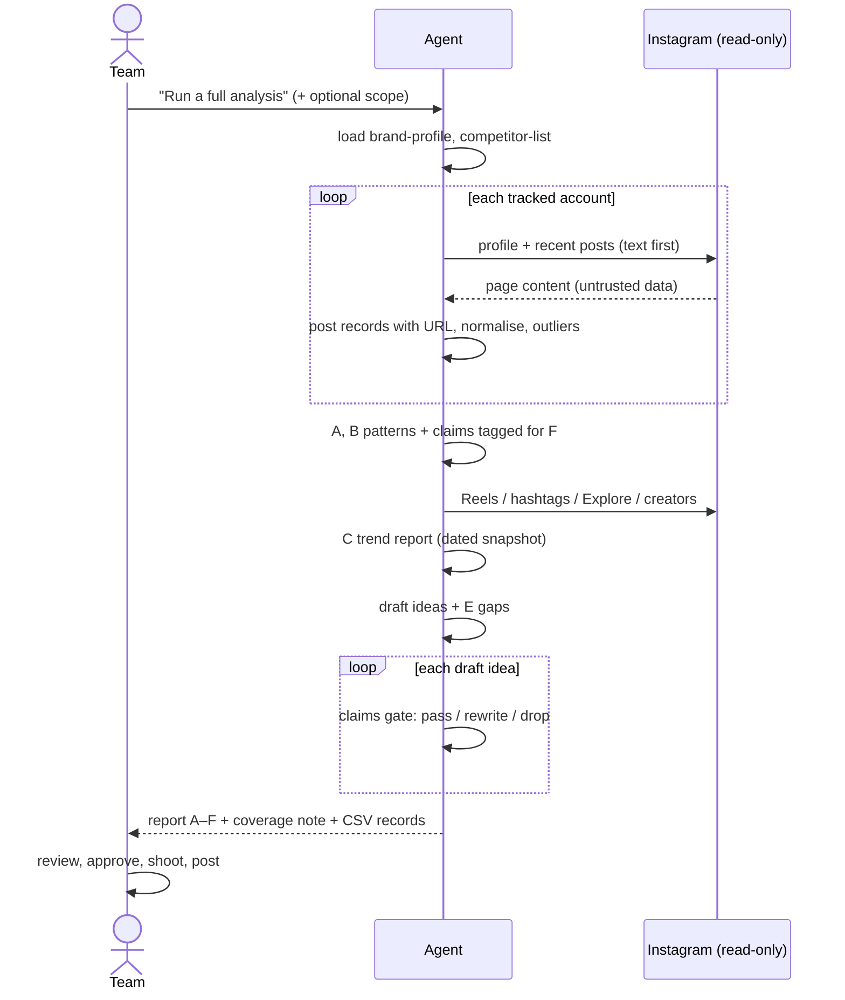

# Architecture

| Layer | What | Role |
|---|---|---|
| Orchestrator | Claude Project + [system prompt](../agent/system-prompt.md) | Routes a request to one stage or the full A–F run (routing table in the prompt); applies rules |
| Config | `brand-profile`, `competitor-list` project docs | Everything brand-specific; swapping them retargets the agent |
| Skills | [skills/](../skills) | One job each, with inputs, outputs and stop conditions |
| Policy gate | [claims-check](../skills/claims-check/SKILL.md) | Tags competitor claims; blocks our ideas until they pass |
| Browser | Claude in Chrome (read-only) | Instagram profiles, Reels, hashtags, Explore. Page content is untrusted |
| Records | [post records](../schemas/post-record.md), [idea records](../schemas/idea-record.md), optionally a Google Sheet | Structured, sourced data behind every conclusion |
| Checks | [scripts/](../scripts), [evals/](../evals) | Recompute medians and outliers; seeded test cases |
| Human | Brand / social team | Sets scope, confirms claims, approves and shoots the ideas. The agent never posts |

## Flow of a full run

## Why brand-agnostic
The first version was written for one brand, with everything inline ([original prompt](../examples/dhees-pet-company/original-prompt.md)). Pulling brand facts, competitors and the content taxonomy out into config keeps the method (metrics, guardrails, output contract) reusable. It also makes clear which parts are judgement and which are data. [coverage.md](coverage.md) maps every line of the original to where it now lives.
