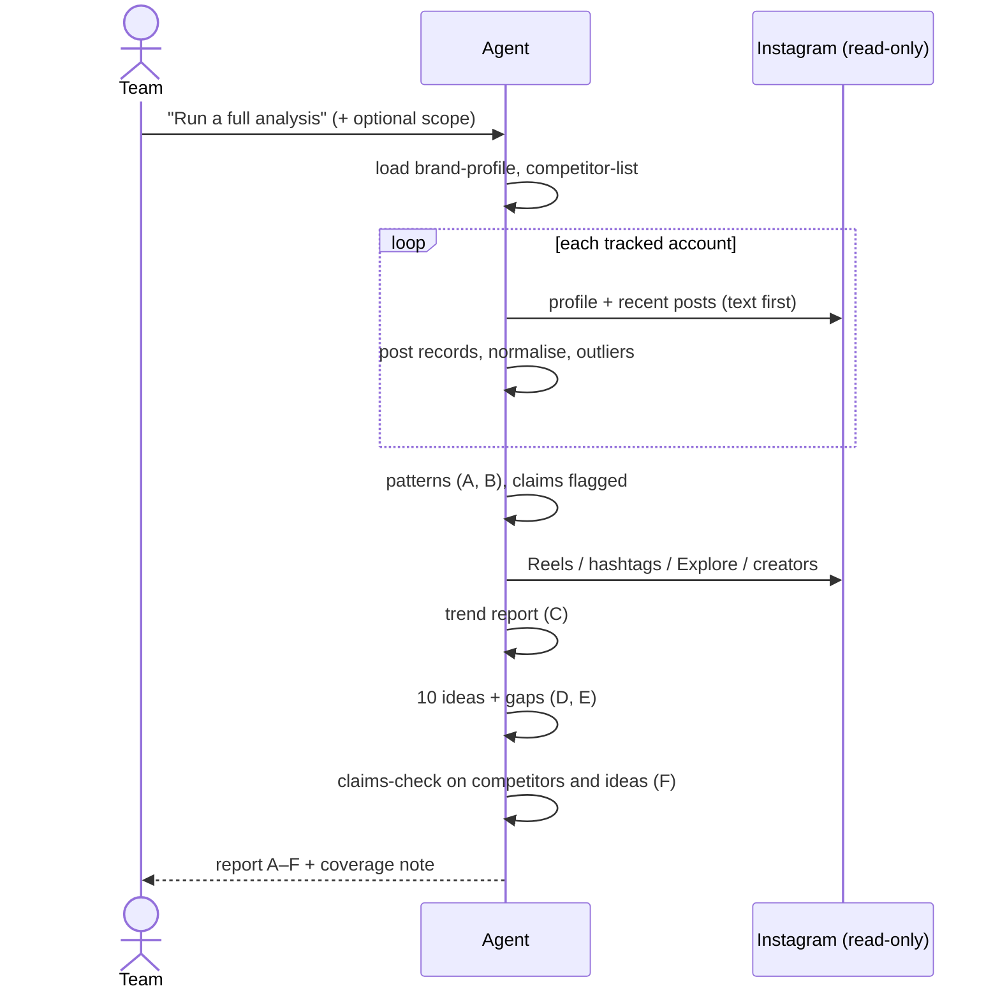

# Architecture

| Layer | What | Role |
|---|---|---|
| Orchestrator | Claude Project + [system prompt](../agent/system-prompt.md) | Routes a request to one stage or the full A–F run; applies rules |
| Config | `brand-profile`, `competitor-list` project docs | Everything brand-specific; swapping them retargets the agent |
| Skills | [skills/](../skills) | One stage each, with inputs, outputs and stop conditions |
| Browser | Claude in Chrome (read-only) | Instagram profiles, Reels, hashtags, Explore |
| Records | [post-record schema](../schemas/post-record.md), optionally a Google Sheet | Structured data behind every conclusion |
| Human | Brand / social team | Supplies posts or scope, confirms claims, shoots the ideas |

## Flow of a full run

## Why brand-agnostic
The first version was written for one brand with everything inline. Pulling brand facts and competitors out into config keeps the method (metrics, guardrails, output contract) reusable, and makes it obvious which parts are judgement and which are data.
